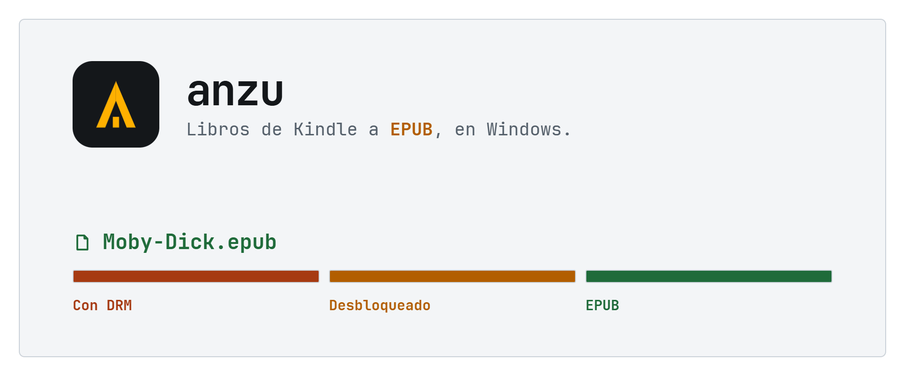

  <picture>
    <source media="(prefers-color-scheme: dark)" srcset="assets/motion/hero-es-dark.gif">
    
  </picture>

<a href="README.md">English</a> · <b>Español</b>

<h1 align="center">Anzu: convierte libros de Kindle a EPUB en Windows</h1>

  <b>Una app gratuita para Windows que convierte los libros que descargaste con la app de Kindle en archivos EPUB, 
  para que puedas leerlos en otras apps y otros lectores. Sin Calibre y sin línea de comandos.</b>

  
  
  
  

  <a href="https://anzu.ilien.dev/es/"><b>Sitio web y demo en vivo</b></a> ·
  <a href="#instalación"><b>Instalación</b></a> ·
  <a href="#cómo-se-usa"><b>Cómo se usa</b></a> ·
  <a href="#úsala-con-responsabilidad"><b>Úsala con responsabilidad</b></a> ·
  <a href="#preguntas"><b>Preguntas</b></a> ·
  <a href="docs/technical-overview.md"><b>Detalles técnicos (en inglés)</b></a>

---

Los libros que compras en Kindle solo se abren en las apps y los dispositivos de Amazon.
Están bloqueados con DRM, una protección que ata cada libro a tu cuenta. Si quieres leer
uno en otra app de lectura, o usarlo en una herramienta tuya, lo necesitas en EPUB, el
formato abierto que entienden casi todos los demás lectores.

Hacerlo a mano es tedioso. Hay que encontrar una herramienta para quitar el DRM, comprobar
que su versión funciona con tu versión de la app de Kindle, rebuscar en carpetas ocultas y
luego pasar el archivo de KFX (el formato de Kindle) a EPUB.

Anzu hace todo eso en una sola ventana. Encuentra los libros que descargaste con la app de
Kindle para PC, comprueba la herramienta de desbloqueo antes de cada uso, pregunta antes de
cerrar nada y guarda cada libro como archivo EPUB en la carpeta que elijas. Si algo no
cuadra, se detiene y te explica por qué en lugar de adivinar.

Puedes ver la app real funcionando, con libros de ejemplo, en el
**[sitio web](https://anzu.ilien.dev/es/)**.

## Úsala con responsabilidad

> [!WARNING]
> **Anzu es solo para uso personal, y solo con libros que obtuviste de forma legal.**
>
> - **Quitar el DRM puede ser ilegal donde vives.** Muchos países, entre ellos Estados
>   Unidos (por la ley DMCA) y los estados de la Unión Europea, prohíben saltarse las
>   protecciones anticopia, y hacerlo puede acarrear multas u otras sanciones. Revisa la
>   ley de tu país antes de usar Anzu.
> - **Va en contra de las condiciones de Amazon.** Al usar Kindle aceptas las Condiciones
>   de uso de la Tienda Kindle, y esas condiciones no permiten quitar el DRM de tus libros.
> - **Úsala solo con libros que compraste o que lees con una suscripción que pagas.**
> - **Nunca compartas los EPUB que obtengas.** No se los envíes a nadie, no los subas ni
>   los publiques en ningún sitio. Compartir un libro al que le quitaste el DRM es
>   piratería, es ilegal y perjudica a quienes lo escribieron.
>
> Tú eres responsable del uso que hagas de Anzu.

### Por qué la creé

Hice Anzu para mí, para practicar inglés. Tengo otra app,
[Ogmios](https://github.com/ilien-dev/ogmios), con la que practico inglés, y quería usar los
libros que leo como material. Con un libro en EPUB puedo separarlo en capítulos y sacar de
ahí vocabulario en inglés para estudiar. Esa es toda la idea: usar un libro que pagué en
otra app mía. Anzu nunca tuvo como fin quitarle el DRM a un libro para pasárselo a otras
personas. Eso es ilegal y no debe hacerse nunca.

## Qué necesitas

- Una computadora con **Windows 10 u 11**.
- La **app de Kindle de Microsoft Store**, con tu cuenta de Amazon iniciada y los libros
  que quieras ya descargados.
- Conexión a internet, para que Anzu compruebe la herramienta de desbloqueo antes de usarla.

## Instalación

1. Descarga el archivo cuyo nombre termina en `setup.exe` desde la
   [última versión](https://github.com/ilien-dev/anzu/releases/latest).
2. Ábrelo y sigue los pasos. No pide permisos de administrador.
3. La primera vez, Windows puede mostrar un aviso azul («Windows protegió su PC») porque el
   instalador aún no está firmado. Elige **Más información** y luego **Ejecutar de todas
   formas**.

Mientras está abierta, Anzu busca versiones nuevas por su cuenta y solo instala una cuando
tú lo pides. Para quitarla, desinstala Anzu desde Configuración › Aplicaciones, como
cualquier otro programa.

## Cómo se usa

1. **Descarga tus libros** en la app de Kindle, como siempre.
2. **Abre Anzu.** Encuentra la app de Kindle y muestra tus libros. Hasta que un libro se
   desbloquea ves un código en lugar del título; el título real aparece al desbloquearlo.
3. **Marca los libros que quieras** y elige la carpeta donde irán los EPUB
   (`Documents\EPUB` por defecto).
4. **Pulsa el botón.** Siempre dice lo que va a pasar, por ejemplo «Desbloquear y
   convertir 2 libros». La app de Kindle tiene que estar cerrada para desbloquear, así que
   Anzu te pide permiso antes de cerrarla.

Cada libro muestra su avance en una pequeña pista de tres pasos: con DRM, desbloqueado,
EPUB listo. Si un libro falla, los demás siguen. Conviene saberlo: la herramienta
desbloquea todos los libros descargados que aún tienen DRM, no solo los que marcaste; solo
los marcados se convierten a EPUB.

La ventana está en inglés o en español, con tema claro u oscuro; ambas cosas se eligen en
el botón de ajustes (el engranaje de arriba).

## Qué libros funcionan

- **Funcionan:** novelas y otros libros que son sobre todo texto, con sus capítulos,
  títulos, cursivas y negritas, enlaces, imágenes, portada e índice.
- **En parte:** las listas y las tablas conservan su texto, pero pierden su formato.
- **No funcionan:** cómics, manga, libros ilustrados infantiles y otros libros de diseño
  fijo, ni diccionarios.

## Cómo protege tu cuenta

- Para desbloquear tus libros, la herramienta necesita claves secretas de tu cuenta de
  Amazon. Anzu las guarda en tu computadora, en `%LOCALAPPDATA%\anzu\keys` y
  `%LOCALAPPDATA%\anzu\work`. **Trata esas dos carpetas como una contraseña: nunca las
  compartas ni las subas a ningún sitio.**
- Anzu nunca muestra esos secretos en pantalla ni los escribe en su registro.
- Anzu nunca cambia nada dentro de la carpeta de la app de Kindle.
- El DRM lo quita una herramienta aparte, de código abierto y conocida
  ([las DeDRM tools de Satsuoni](https://github.com/Satsuoni/DeDRM_tools)). Anzu la
  descarga de sus publicaciones oficiales, comprueba que el archivo no fue alterado y se
  niega a ejecutarla si algo no coincide. Anzu no contiene código de descifrado.

## Preguntas

**¿Anzu es gratis?**
Sí. Es libre y de código abierto, con licencia GPL-3.0.

**¿Funciona en Mac o Linux?**
No. Anzu solo funciona en Windows 10 y 11, con la app de Kindle de Microsoft Store.

**¿Necesito Calibre?**
No. Anzu tiene su propio conversor de KFX a EPUB, así que no necesitas Calibre ni ningún
complemento.

**¿Puedo leer el EPUB en un Kobo, un teléfono o una tableta?**
Sí, el EPUB funciona en la mayoría de las apps de lectura y lectores electrónicos. Recuerda
que los archivos son solo para ti: cópialos únicamente a tus propios dispositivos.

**¿Puede convertir a MOBI, AZW3 o PDF?**
No. Anzu solo crea archivos EPUB.

**¿Por qué Anzu a veces se niega a desbloquear?**
Porque no pudo asegurarse de que la herramienta de desbloqueo es segura y compatible: por
ejemplo, la app de Kindle se actualizó y la herramienta todavía no admite esa versión, o no
hay conexión para comprobarlo. Anzu te dice el motivo en pantalla. Los libros ya
desbloqueados se pueden seguir convirtiendo.

**¿De dónde viene el nombre?**
En la mitología mesopotámica, Anzu es el ave que robó a los dioses la Tablilla de los
Destinos. El logo es una A formada por dos alas abiertas sobre una tablilla.

## Para quien quiera saber más

Cómo encajan las piezas, cuándo se niega Anzu a desbloquear, dónde guarda cada archivo, la
línea de comandos, las limitaciones conocidas y cómo compilarla desde el código están en la
**[descripción técnica](docs/technical-overview.md)**, en inglés. Para proponer un cambio,
lee [CONTRIBUTING.md](CONTRIBUTING.md).

## Créditos

- **Satsuoni**, por la herramienta de desbloqueo.
- **John Howell** (jhowell), cuyo complemento KFX Input es la referencia del formato KFX.
- **JetBrains Mono**, la tipografía de la interfaz, con licencia SIL Open Font License 1.1
  (`crates/anzu/assets/fonts/OFL.txt`).

## Licencia

GPL-3.0-or-later. Anzu es un proyecto independiente: no lo hace, respalda ni apoya Amazon.
Kindle es una marca de Amazon.com, Inc. o sus filiales.
