  <picture>
    <source media="(prefers-color-scheme: dark)" srcset="assets/hero-dark.svg">
    
  </picture>

<a href="README.md">English</a> · <b>Español</b>

<h1 align="center">Anzu: lee los libros de Kindle que compraste en cualquier lector</h1>

<b>Una app gratuita para Windows que convierte tus libros de Kindle en archivos EPUB en un solo paso. Sin Calibre y sin línea de comandos.</b>

  
  
  
  

  <a href="#lo-que-obtienes">Lo que obtienes</a> ·
  <a href="#cómo-funciona">Cómo funciona</a> ·
  <a href="#instalación">Instalación</a> ·
  <a href="#tu-cuenta-está-a-salvo">Tu cuenta</a> ·
  <a href="#preguntas">Preguntas</a> ·
  <a href="docs/technical-overview.md">Detalles técnicos (en inglés)</a>

---

**Anzu convierte los libros de Kindle que compraste en archivos EPUB que puedes leer donde
quieras.** Amazon ata los libros de Kindle a sus propias apps con DRM, una protección
anticopia. ¿Te pasas a un Kobo o lees en el móvil? Anzu encuentra los libros que
descargaste con la app de Kindle en tu PC con Windows, quita ese candado y guarda cada uno
como EPUB, el formato que abre casi cualquier otro lector. Una ventana, un botón, sin
Calibre. Puedes probar la app real con libros de ejemplo en el
[sitio web](https://anzu.ilien.dev/es/).

## Úsala con responsabilidad

> [!WARNING]
> **Para uso personal, con libros que conseguiste legalmente.**
>
> - **Puede ir contra la ley de tu país.** Muchos países, entre ellos Estados Unidos (por
>   la DMCA) y los miembros de la Unión Europea, prohíben saltarse la protección anticopia.
>   Revisa antes la ley de tu país.
> - **Va contra los términos de Amazon.** Las Condiciones de Uso de la Tienda Kindle no
>   permiten quitar el DRM de tus libros.
> - **Solo libros que pagaste:** comprados, o leídos con una suscripción que pagas.
> - **Nunca compartas los archivos EPUB.** Enviar o subir un libro al que le quitaste el
>   DRM es piratería, es ilegal y perjudica a quienes lo escribieron.
>
> Tú eres responsable de cómo usas Anzu.

## Lo que obtienes

<picture>
  <source media="(prefers-color-scheme: dark)" srcset="assets/es/readme/features-dark.svg">
  
</picture>

- **Tus libros en cualquier lector.** Kobo, PocketBook, un móvil o una tableta: el EPUB se
  abre casi en todas partes.
- **Nada extra que instalar.** Ni Calibre, ni plugins, ni buscar una versión vieja de la app
  de Kindle. Anzu tiene su propio conversor.
- **Un botón para todo el trabajo.** Siempre dice lo que va a hacer, por ejemplo
  “Desbloquear y convertir 2 libros”.
- **Tu biblioteca de Kindle se queda como está.** Anzu solo lee la carpeta de Kindle. Nunca
  cambia ni borra tus libros allí.
- **Una respuesta clara si algo no cuadra.** Si la herramienta que quita el DRM todavía no
  funciona con tu app de Kindle, Anzu se detiene y te dice por qué en vez de adivinar.

## Cómo funciona

<picture>
  <source media="(prefers-color-scheme: dark)" srcset="assets/es/readme/how-dark.svg">
  
</picture>

Primero descarga tus libros en la app de Kindle, como siempre, y abre Anzu. Los encuentra y
los pone en estantes: por desbloquear, listos para EPUB o ya en EPUB. Después:

1. **Marca tus libros** y elige dónde van los archivos EPUB (`Documents\EPUB` por defecto).
2. **Pulsa un botón.** Dice lo que va a hacer, por ejemplo “Desbloquear y convertir 2
   libros”.
3. **Deja que cierre Kindle.** La app de Kindle tiene que estar cerrada para desbloquear,
   así que Anzu pregunta antes.
4. **Espera el EPUB.** Cada libro llena una barra de tres colores: con DRM, desbloqueado,
   EPUB listo.

Si un libro falla, los demás siguen. Bueno saberlo: el desbloqueo abre todos los libros
descargados que aún tienen DRM, como copias fuera de la carpeta de Kindle, y solo los
marcados se vuelven EPUB. Más en el
[resumen técnico (en inglés)](docs/technical-overview.md#how-the-parts-fit-together).

## Instalación

> [!IMPORTANT]
> **Necesitas Windows 10 u 11** y la app de Kindle de Microsoft Store, con tu sesión
> iniciada y tus libros ya descargados. Anzu también necesita conexión a internet para
> revisar la herramienta de desbloqueo antes de usarla.

1. Descarga el archivo cuyo nombre termina en `setup.exe` desde la
   [última versión](https://github.com/ilien-dev/anzu/releases/latest).
2. Ábrelo y sigue los pasos. No pide permisos de administrador.
3. La primera vez, Windows puede mostrar “Windows protegió tu PC”, porque el instalador aún
   no está firmado. Elige “Más información” y luego “Ejecutar de todas formas”.

Anzu te avisa cuando hay una versión nueva y solo la instala cuando tú lo dices. Para
quitarla, desinstala Anzu desde Configuración › Aplicaciones como cualquier otro programa.

## Tu cuenta está a salvo

<picture>
  <source media="(prefers-color-scheme: dark)" srcset="assets/es/readme/privacy-dark.svg">
  
</picture>

- **Tus claves se quedan en tu PC.** Para desbloquear tus libros, la herramienta necesita
  claves secretas de tu cuenta de Amazon, y las toma de la app de Kindle de tu PC: nunca
  escribes tu contraseña de Amazon. Anzu las guarda en tu computadora, nunca las
  muestra en pantalla y nunca las escribe en su registro. Trata las carpetas que las guardan
  (`%LOCALAPPDATA%\anzu\keys` y `work`) como una contraseña.
- **Tus libros se quedan en tu PC.** No se sube nada a ninguna parte.
- **En línea solo se revisa la herramienta.** El DRM lo quita una herramienta de código
  abierto muy conocida, [las DeDRM tools de Satsuoni](https://github.com/Satsuoni/DeDRM_tools).
  Anzu la descarga de sus versiones oficiales, comprueba que el archivo no fue alterado y
  solo entonces la ejecuta en tu PC.

Dónde vive cada archivo y qué envía Anzu a GitHub está en el
[resumen técnico (en inglés)](docs/technical-overview.md#privacy-and-network).

## Preguntas

<b>¿Anzu es gratis?</b>

Sí. Es gratuita y de código abierto, con licencia GPL-3.0.

<b>¿Qué libros funcionan?</b>

Novelas y otros libros que son sobre todo texto, con sus capítulos, títulos, cursivas y
negritas, enlaces, imágenes, portada e índice. Las listas y las tablas conservan el texto
pero pierden su forma. No funcionan los cómics, el manga, los libros ilustrados infantiles y
otros de diseño fijo, ni los diccionarios.

<b>¿Puedo leer el EPUB en un Kobo, un móvil o una tableta?</b>

Sí, el EPUB funciona en la mayoría de las apps de lectura y los lectores electrónicos. Los
archivos son solo para ti: cópialos únicamente a tus propios dispositivos.

<b>¿Funciona en Mac o Linux, o con un Kindle?</b>

No. Anzu funciona en Windows 10 y 11 y lee los libros de la app de Kindle de Microsoft
Store. Los libros que solo están en un Kindle tienen que descargarse primero en esa app.

<b>¿Necesito Calibre?</b>

No. Anzu tiene su propio conversor del formato de Kindle (KFX) a EPUB, así que no necesitas
Calibre ni ningún plugin.

<b>¿Puede crear archivos MOBI, AZW3 o PDF?</b>

No. Anzu solo crea archivos EPUB.

<b>¿Por qué Anzu a veces se niega a desbloquear?</b>

Porque no pudo asegurarse de que la herramienta de desbloqueo es segura y funciona con tu
app de Kindle: por ejemplo, la app de Kindle se actualizó y la herramienta todavía no admite
esa versión, o no hay conexión para comprobarlo. Anzu muestra el motivo en pantalla. Los
libros que ya están desbloqueados se pueden seguir convirtiendo.

Más respuestas, desde dónde guarda Anzu cada archivo hasta qué hace cuando se actualiza la
app de Kindle, están en el [resumen técnico (en inglés)](docs/technical-overview.md).

## Sobre Anzu

En la mitología mesopotámica, Anzu es el ave que robó a los dioses la Tablilla de los
Destinos. El logo es un bloque que se convierte en líneas de texto: un libro bloqueado que
se vuelve EPUB.

Hice Anzu para mí, para practicar inglés con los libros que leo en
[Ogmios](https://github.com/ilien-dev/ogmios), otra app mía. Nunca fue pensada para pasar
libros a nadie más.

**Para los curiosos:** cómo está hecha, sus límites conocidos, los créditos y cómo compilarla
están en el [resumen técnico (en inglés)](docs/technical-overview.md). Gracias a Satsuoni por
la herramienta de desbloqueo. Para proponer un cambio, lee [CONTRIBUTING.md](CONTRIBUTING.md).

## Licencia

GPL-3.0-or-later. Anzu es un proyecto independiente. No está hecho, respaldado ni apoyado por
Amazon. Kindle es una marca de Amazon.com, Inc. o sus filiales.
