  <picture>
    <source media="(prefers-color-scheme: dark)" srcset="assets/hero-dark.svg">
    
  </picture>

<b>English</b> · <a href="README.es.md">Español</a>

<h1 align="center">Anzu: read the Kindle books you bought on any e-reader</h1>

<b>A free Windows app that turns your Kindle books into EPUB files in one step. No Calibre, no command line.</b>

  
  
  
  

  <a href="#what-you-get">What you get</a> ·
  <a href="#how-it-works">How it works</a> ·
  <a href="#install">Install</a> ·
  <a href="#your-account-stays-safe">Your account</a> ·
  <a href="#questions">Questions</a> ·
  <a href="docs/technical-overview.md">Technical details</a>

---

**Anzu turns the Kindle books you bought into EPUB files you can read anywhere.** Amazon
locks Kindle books to its own apps with DRM, a copy protection. Moving to a Kobo, or
reading on your phone? Anzu finds the books you downloaded with the Kindle app on your
Windows PC, removes that lock and saves each one as an EPUB, the format almost every other
e-reader opens. One window, one button, no Calibre. You can try the real app with sample
books on the [website](https://anzu.ilien.dev/).

## Use it responsibly

> [!WARNING]
> **For personal use, with books you got legally.**
>
> - **It may be against your country's law.** Many countries, including the United
>   States (under the DMCA) and the members of the European Union, forbid getting around
>   copy protection. Check the law in your country first.
> - **It goes against Amazon's terms.** The Kindle Store Terms of Use do not allow
>   removing the DRM of your books.
> - **Only books you paid for:** bought, or read through a subscription you pay for.
> - **Never share the EPUB files.** Sending or uploading a book whose DRM you removed is
>   piracy, it is illegal, and it hurts the authors who wrote it.
>
> You are responsible for how you use Anzu.

## What you get

<picture>
  <source media="(prefers-color-scheme: dark)" srcset="assets/readme/features-dark.svg">
  
</picture>

- **Your books on any reader.** Kobo, PocketBook, a phone or a tablet: EPUB opens almost
  everywhere.
- **No extra tools.** No Calibre, no plugins, no old version of the Kindle app to hunt
  down. Anzu has its own converter.
- **One button for the whole job.** It always says what it is about to do, for example
  “Unlock and convert 2 books”.
- **Your Kindle library stays as it is.** Anzu only reads the Kindle folder. It never
  changes or deletes your books there.
- **A clear answer when something is off.** If the tool that removes the DRM does not
  support your Kindle app yet, Anzu stops and tells you why instead of guessing.

## How it works

<picture>
  <source media="(prefers-color-scheme: dark)" srcset="assets/readme/how-dark.svg">
  
</picture>

First download your books in the Kindle app, as you always do, and open Anzu. It finds
them and puts them on shelves: to unlock, ready for EPUB, or already in EPUB. Then:

1. **Tick your books** and choose where the EPUB files go (`Documents\EPUB` by default).
2. **Press one button.** It says what it will do, for example “Unlock and convert 2 books”.
3. **Let it close Kindle.** The Kindle app has to be closed to unlock, so Anzu asks first.
4. **Wait for the EPUB.** Each book fills a bar of three colours: with DRM, unlocked, EPUB
   ready.

If one book fails, the others keep going. Good to know: the unlock step unlocks every
downloaded book that still has DRM, as copies outside the Kindle folder, and only the
ticked ones become EPUB. More in the
[technical overview](docs/technical-overview.md#how-the-parts-fit-together).

## Install

> [!IMPORTANT]
> **You need Windows 10 or 11** and the Kindle app from the Microsoft Store, signed in, with
> your books already downloaded. Anzu also needs an internet connection to check the unlock
> tool before it uses it.

1. Download the file whose name ends in `setup.exe` from the
   [latest release](https://github.com/ilien-dev/anzu/releases/latest).
2. Open it and follow the steps. It does not ask for administrator rights.
3. Windows may show “Windows protected your PC” the first time, because the installer is
   not signed yet. Choose “More info”, then “Run anyway”.

Anzu tells you when there is a new version and installs it only when you say so. To remove
it, uninstall Anzu from Settings › Apps like any other program.

## Your account stays safe

<picture>
  <source media="(prefers-color-scheme: dark)" srcset="assets/readme/privacy-dark.svg">
  
</picture>

- **Your keys stay on your PC.** To unlock your books, the unlock tool needs secret keys
  from your Amazon account, and takes them from the Kindle app on your PC: you never type
  your Amazon password. Anzu keeps them on your computer, never shows them on screen and
  never writes them to its log. Treat the folders that hold them
  (`%LOCALAPPDATA%\anzu\keys` and `work`) like a password.
- **Your books stay on your PC.** Nothing is uploaded anywhere.
- **Only the tool is checked online.** The DRM is removed by a well-known open-source tool,
  [Satsuoni's DeDRM tools](https://github.com/Satsuoni/DeDRM_tools). Anzu downloads it from
  its official releases, checks that the file was not altered, and only then runs it on
  your PC.

Where each file lives and what Anzu sends to GitHub are in the
[technical overview](docs/technical-overview.md#privacy-and-network).

## Questions

<b>Is Anzu free?</b>

Yes. It is free and open source, under the GPL-3.0 license.

<b>Which books work?</b>

Novels and other books that are mostly text, with their chapters, headings, italics and
bold, links, pictures, cover and table of contents. Lists and tables keep their text but
lose their layout. Comics, manga, children's picture books and other fixed-layout books,
and dictionaries, do not work.

<b>Can I read the EPUB on a Kobo, a phone or a tablet?</b>

Yes, EPUB works in most reading apps and e-readers. The files are for you alone: copy them
only to your own devices.

<b>Does it work on Mac or Linux, or with a Kindle device?</b>

No. Anzu runs on Windows 10 and 11 and reads the books of the Kindle app from the Microsoft
Store. Books that are only on a Kindle e-reader have to be downloaded in that app first.

<b>Do I need Calibre?</b>

No. Anzu has its own converter from Kindle's format (KFX) to EPUB, so you need no Calibre
and no plugin.

<b>Can it make MOBI, AZW3 or PDF files?</b>

No. Anzu only makes EPUB files.

<b>Why does Anzu sometimes refuse to unlock?</b>

Because it could not make sure the unlock tool is safe and works with your Kindle app: for
example, the Kindle app updated and the tool does not support that version yet, or there is
no connection to check. Anzu shows the reason on screen. Books that are already unlocked
can still be converted.

More answers, from where Anzu keeps each file to what it does when the Kindle app updates,
are in the [technical overview](docs/technical-overview.md).

## About Anzu

In Mesopotamian myth, Anzu is the bird that stole the Tablet of Destinies from the gods.
The logo is a block that turns into lines of text: a locked book becoming an EPUB.

I made Anzu for myself, to practise English with the books I read in
[Ogmios](https://github.com/ilien-dev/ogmios), another app of mine. It was never meant to
pass books on to anyone else.

**For the curious:** how it is built, its known limits, the credits and how to build it
from source are in the [technical overview](docs/technical-overview.md). Thanks to Satsuoni
for the unlock tool. To propose a change, read [CONTRIBUTING.md](CONTRIBUTING.md).

## License

GPL-3.0-or-later. Anzu is an independent project. It is not made, endorsed or supported by
Amazon. Kindle is a trademark of Amazon.com, Inc. or its affiliates.
