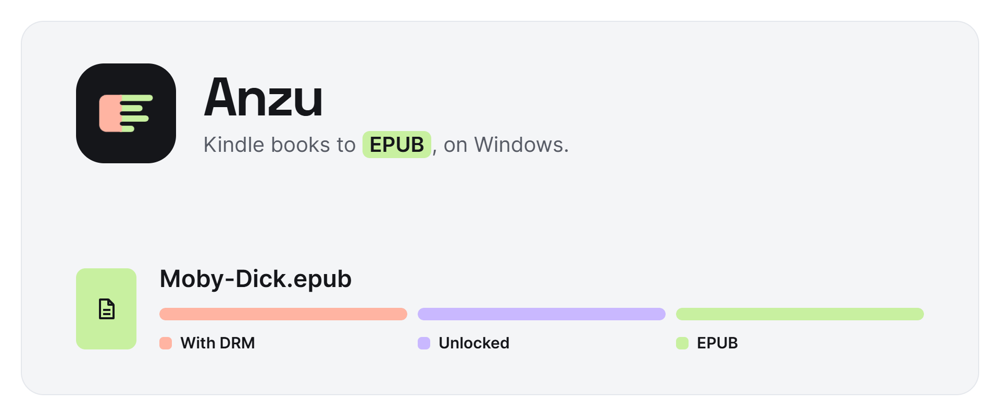

  <picture>
    <source media="(prefers-color-scheme: dark)" srcset="assets/motion/anzu-hero-en-dark.gif">
    
  </picture>

<b>English</b> · <a href="README.es.md">Español</a>

<h1 align="center">Anzu: convert Kindle books to EPUB on Windows</h1>

  <b>A free Windows app that turns the books you downloaded with the Kindle app into EPUB files, 
  so you can read them in other apps and on other e-readers. No Calibre, no command line.</b>

  
  
  
  

  <a href="https://anzu.ilien.dev/"><b>Website and live demo</b></a> ·
  <a href="#install"><b>Install</b></a> ·
  <a href="#how-to-use-it"><b>How to use it</b></a> ·
  <a href="#use-it-responsibly"><b>Use it responsibly</b></a> ·
  <a href="#questions"><b>Questions</b></a> ·
  <a href="docs/technical-overview.md"><b>Technical details</b></a>

---

Books you buy on Kindle can only be opened in Amazon's apps and devices. They are locked
with DRM, a protection that ties each book to your account. If you want to read one of
them in a different reading app, or load it into a tool of your own, you need it as an
EPUB, the open format almost every other reader understands.

Doing that by hand is tedious. You have to find a DRM removal tool, check that its version
works with your version of the Kindle app, dig through hidden folders, and then convert
the file from KFX (Kindle's format) to EPUB.

Anzu does all of that in one window. It finds the books you downloaded with the Kindle app
for PC, checks the unlock tool before every run, asks before it closes anything, and saves
each book as an EPUB file in the folder you choose. When something does not look right, it
stops and tells you why instead of guessing.

You can see the real app running, with sample books, on the
**[website](https://anzu.ilien.dev/)**.

## Use it responsibly

> [!WARNING]
> **Anzu is for personal use only, and only with books you got legally.**
>
> - **Removing DRM can be against the law where you live.** Many countries, including the
>   United States (under the DMCA) and the member states of the European Union, forbid
>   getting around copy protection, and breaking that rule can lead to fines or other
>   penalties. Check the law in your country before you use Anzu.
> - **It goes against Amazon's terms.** When you use Kindle you accept the Kindle Store
>   Terms of Use, and those terms do not allow removing the DRM of your books.
> - **Only use books you bought or that you read through a subscription you pay for.**
> - **Never share the EPUB files you make.** Do not send them to anyone, upload them or
>   post them anywhere. Sharing a book whose DRM you removed is piracy, it is illegal, and
>   it hurts the authors who wrote it.
>
> You are responsible for how you use Anzu.

### Why I built it

I made Anzu for myself, to practise English. I wrote another app,
[Ogmios](https://github.com/ilien-dev/ogmios), where I practise English, and I wanted to
use the books I read as material for it. With a book as an EPUB I can split it into
chapters and pull out English vocabulary to study. That is the whole idea: using a book I
paid for, in a different app of my own. Anzu was never meant to remove the DRM from a book
so it can be passed on to other people. That would be illegal, and it should never be done.

## What you need

- A computer with **Windows 10 or 11**.
- The **Kindle app from the Microsoft Store**, signed in to your Amazon account, with the
  books you want already downloaded.
- An internet connection, so Anzu can check the unlock tool before it uses it.

## Install

1. Download the file whose name ends in `setup.exe` from the
   [latest release](https://github.com/ilien-dev/anzu/releases/latest).
2. Open it and follow the steps. It does not ask for administrator rights.
3. Windows may show a blue “Windows protected your PC” warning the first time, because the
   installer is not signed yet. Choose **More info**, then **Run anyway**.

Anzu checks for new versions on its own while it is open, and only installs one when you
say so. To remove it, uninstall Anzu from Settings › Apps like any other program.

## How to use it

1. **Download your books** in the Kindle app, as you normally do.
2. **Open Anzu.** It finds the Kindle app and puts your books on shelves by what they still
   need: to unlock, ready for EPUB, or already in EPUB. Each book shows the title
   the Kindle app has for it; one without a title there shows its code until it is unlocked.
3. **Tick the books you want.** The side panel lists them with what will be done to each.
   Choose the folder where the EPUB files will go
   (`Documents\EPUB` by default).
4. **Press the button.** It always says what is about to happen, for example
   “Unlock and convert 2 books”. The Kindle app has to be closed for the unlock, so Anzu
   asks your permission before it closes it.

Each book shows its progress on a small three-step track: with DRM, unlocked, EPUB ready.
If one book fails, the others keep going. Good to know: the unlock tool unlocks every
downloaded book that still has DRM, not only the ones you ticked; only the ticked ones are
converted to EPUB.

The window is in English or Spanish, in a light or dark theme, both chosen from the
settings button (the cog at the top).

## What books work

- **Works:** novels and other books that are mostly text, with their chapters, headings,
  italics and bold, links, pictures, cover and table of contents.
- **Partly:** lists and tables keep their text but lose their layout.
- **Does not work:** comics, manga, children's picture books and other fixed-layout books,
  and dictionaries.

## Keeping your account safe

- To unlock your books, the unlock tool needs secret keys from your Amazon account. Anzu
  keeps them on your computer, in `%LOCALAPPDATA%\anzu\keys` and `%LOCALAPPDATA%\anzu\work`.
  **Treat those two folders like a password: never share them or upload them anywhere.**
- Anzu never shows those secrets on screen or writes them to its log.
- Anzu never changes anything inside the Kindle app's own folder.
- The DRM is removed by a separate, well-known open-source tool
  ([Satsuoni's DeDRM tools](https://github.com/Satsuoni/DeDRM_tools)). Anzu downloads it
  from its official releases, checks that the file has not been altered, and refuses to run
  it if anything does not match. Anzu itself contains no decryption code.

## Questions

**Is Anzu free?**
Yes. It is free and open source, under the GPL-3.0 license.

**Does it work on Mac or Linux?**
No. Anzu only runs on Windows 10 and 11, with the Kindle app from the Microsoft Store.

**Do I need Calibre?**
No. Anzu has its own KFX to EPUB converter, so you do not need Calibre or any plugin.

**Can I read the EPUB on a Kobo, a phone or a tablet?**
Yes, EPUB works in most reading apps and e-readers. Remember that the files are for you
alone: copy them only to your own devices.

**Can it convert to MOBI, AZW3 or PDF?**
No. Anzu only creates EPUB files.

**Why does Anzu stop and refuse to unlock sometimes?**
Because it could not make sure the unlock tool is safe and compatible: for example, the
Kindle app updated and the tool does not support that version yet, or there is no internet
connection to check. Anzu tells you the reason on screen. Books that are already unlocked
can still be converted.

**Where does the name come from?**
In Mesopotamian myth, Anzu is the bird that stole the Tablet of Destinies from the gods.
The logo is an A made of two open wings over a tablet: a lilac wing, a peach wing and a
butter tablet, the colours the app gives a book as it moves from DRM to EPUB.

## For the curious

How the parts fit together, when Anzu refuses to unlock, where it keeps each file, the
command line, the known limitations and how to build it from source are all in the
**[technical overview](docs/technical-overview.md)**. To propose a change, read
[CONTRIBUTING.md](CONTRIBUTING.md).

## Credits

- **Satsuoni**, for the unlock tool.
- **John Howell** (jhowell), whose KFX Input plugin is the reference for the KFX format.
- **Inter** and **Space Grotesk**, the interface typefaces, under the SIL Open Font License
  1.1 (`crates/anzu/assets/fonts/Inter-OFL.txt` and `SpaceGrotesk-OFL.txt`).

## License

GPL-3.0-or-later. Anzu is an independent project. It is not made, endorsed or supported by
Amazon. Kindle is a trademark of Amazon.com, Inc. or its affiliates.
